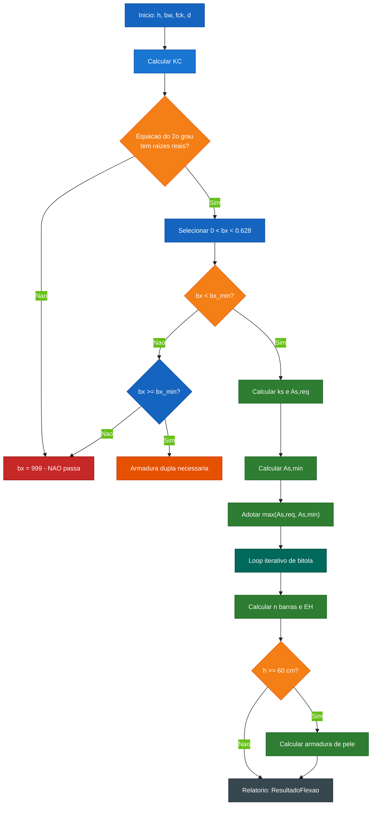
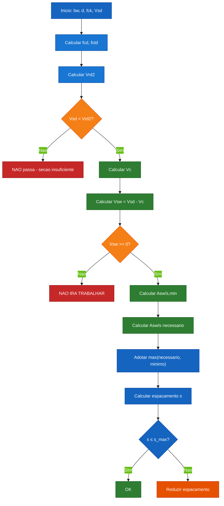
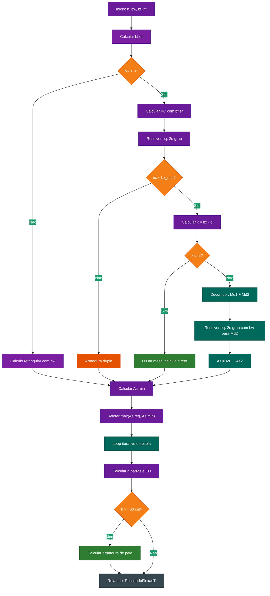

# Documentacao de Calculo – Portica App

Este documento descreve em detalhe o modelo de calculo estrutural implementado no
**Portica App**, com todas as formulas, hipoteses normativas e diagramas de fluxo
das verificacoes.

Para informacoes gerais sobre instalacao, execucao e arquitetura, consulte o
[README.md](../README.md) na raiz do repositorio.

> **Escopo deste documento.** Aqui estao as formulas, hipoteses e derivacoes
> implementadas no app. As tabelas e o texto da NBR 6118 **nao sao
> reproduzidos**: os dados normativos sao citados por item e vivem no codigo
> (por exemplo, `RHO_MIN_TABLE` e `CAA_DATA`). Para os valores, consulte a
> norma vigente.

---

> **Equações renderizadas.** As principais fórmulas deste documento também são
> geradas como imagens PNG (pelo script `generate_equation_images.py`) na pasta
> [`docs/equations/`](equations/) e são usadas na página **Modelo de cálculo**
> da página pública (`site/calculo.html`). Se o script for rodado de novo, as
> imagens devem ser copiadas para `site/img/equations/`.

---

## Indice

1. [Convencoes e unidades](#1-convencoes-e-unidades)
2. [Viga comum (secao retangular) – Flexao](#2-viga-comum-secao-retangular--flexao)
3. [Viga comum (secao retangular) – Cisalhamento](#3-viga-comum-secao-retangular--cisalhamento)
4. [Viga T (mesa colaborante) – Flexao](#4-viga-t-mesa-colaborante--flexao)
5. [Armadura dupla](#5-armadura-dupla)
6. [Armadura de pele](#6-armadura-de-pele)
7. [Dimensionamento iterativo de bitola](#7-dimensionamento-iterativo-de-bitola)
8. [ELS – Flecha](#8-els--flecha)
9. [ELS – Fissuracao](#9-els--fissuracao)
10. [Ajustes manuais ELS](#10-ajustes-manuais-els)
11. [Detalhamento de estribos por regiao](#11-detalhamento-de-estribos-por-regiao)
12. [Classes de agressividade ambiental (CAA)](#12-classes-de-agressividade-ambiental-caa)
13. [Limitacoes conhecidas](#13-limitacoes-conhecidas)
14. [Como verificar um resultado](#14-como-verificar-um-resultado)

---

## 1. Convencoes e unidades

As grandezas seguem o convencionado em calculo estrutural brasileiro:

- Forcas em kN (quilonewton)
- Momentos em kNm (quilonewton metro)
- Comprimentos em cm
- Tensoes do concreto em MPa (`fck`, `fctm`); tensoes de calculo em kN/cm² (`fcd`, `fyd`)
- Resistencia caracteristica do aco `fyk` em kN/cm² (CA-50 = 50 kN/cm² = 500 MPa)
- Areas em cm² (centimetro quadrado)

> **Chaves de arquivo legadas**: os arquivos `.ptc` guardam as chaves
> `fyk_mpa`, `fyk_estribo_mpa` e `fyk_barra_mpa`, mas os **valores estao em
> kN/cm²** (ex.: `50` para CA-50). Os nomes das chaves foram mantidos por
> compatibilidade com projetos existentes; a API do motor usa
> `fyk_kn_cm2`, `fyk_estribo_kn_cm2` e `fyk_barra_kn_cm2`.

Coeficientes de ponderacao e fatores parciais adotados:

| Grandeza            | Simbolo    | Valor       |
|---------------------|------------|-------------|
| Coef. do concreto   | `alpha_c`  | 0,85        |
| Coef. do concreto   | `gamma_c`  | 1,40        |
| Coef. do aco        | `gamma_s`  | 1,15        |
| Coef. das acoes     | `gamma_f`  | 1,30 (PP) / 1,40 (resto) |
| Fator de reducao    | `lambda`   | 0,80 (fck ≤ 50 MPa) |

Referencia normativa principal: **NBR 6118:2023** (Projeto de estruturas de concreto armado).

---

## 2. Viga comum (secao retangular) – Flexao

### 2.1 Altura util

A altura util `d` e calculada descontando-se da altura total `h` o cobrimento nominal
`c`, o diametro do estribo `phi_t` e metade do diametro da barra longitudinal `phi_l`:

```
d = h - c/10 - phi_t/10 - phi_l/20    (cm)
```

Onde:

- `c` vem da tabela `CAA_DATA` conforme a classe de agressividade (mm)
- `phi_t` e o diametro do estribo (mm)
- `phi_l` e o diametro da barra longitudinal mais externa (mm)

### 2.2 Coeficiente KC

O coeficiente `KC` e definido como:

```
KC = bw · d² / Md
```

Sendo:

- `bw`: largura da secao (cm)
- `d`: altura util (cm)
- `Md`: momento de calculo (kN·cm)

### 2.3 Equacao da linha neutra (equilibrio NBR)

A posicao `x` da linha neutra sai do equilibrio de momentos do diagrama retangular
de tensoes (NBR 6118:2023, item 17.2.2):

```
Md = fcd · b · x · (d - 0,4x)
```

Rearranjando, obtem-se uma equacao do segundo grau em `x`:

```
0,4 · x² - d · x + Md/(fcd · b) = 0
```

com `fcd = alpha_c · fck / gamma_c`. A raiz valida e a menor (dominio 2/3) e a
posicao adimensional e `bx = x/d`.

O EP-02.1 removeu a calibracao empirica da planilha original (coeficientes
0,192/0,48 e braco `d - x/2`), que nao era o equilibrio da norma.

### 2.4 Verificacao do dominio de deformacao

Apos o calculo de `bx`, verifica-se o limite de ductilidade da NBR 6118:2023,
item 14.6.4.3 (para o coeficiente de redistribuicao δ = 1,0):

```
bx = x/d ≤ 0,45  (fck ≤ 50 MPa)
bx = x/d ≤ 0,35  (fck > 50 MPa)
```

O resultado e reportado como "SIM" (passa) ou "NAO" (nao passa). O dominio 4
(`bx > 0,628`, aco tracionado sem escoamento) e **recusa explicita**: o motor
nao emite um resultado valido com `As,req = 0` e apenas `As,min`.

Nao confundir este limite com `eta`: `eta = 0,8` para `fck ≤ 50 MPa` e
`eta = 0,8 - (fck - 50)/400` para `fck > 50 MPa` (item 17.2.2-e) e a
profundidade do diagrama retangular de tensoes, nao um limite de ductilidade.
As duas grandezas sao centralizadas em constantes unicas no motor.

### 2.5 Posicao da linha neutra

```
x = bx · d   (cm)
```

### 2.6 Calculo de As (armadura de tracao)

Para a regiao de dominio 2-3 com `bx < bx_min`, a area de aco necessaria e:

```
ks = 1 / (fyd · (1 - 0,4 · bx))
As,req = ks · Md / d
```

O braco de alavanca e `z = d - 0,4x = d · (1 - 0,4 · bx)`, de modo que
`As,req = Md / (fyd · z)`.

A armadura minima e dada por:

```
As,min = rho_min · bw · h / 100
```

Sendo `rho_min` lido da tabela `RHO_MIN_TABLE` (implementada em
`core/calculos/engenharia.py`), que reproduz os valores da taxa minima de
armadura de flexao da **NBR 6118:2023, item 17.3.5.2.1** para as secoes
retangular e T. A tabela normativa **nao e reproduzida aqui**: ela vive no
codigo, como dado de entrada do calculo, e deve ser conferida na norma
vigente (a tabela e interpolada linearmente entre os pontos da norma).

A armadura adotada e o maior valor entre `As,req` e `As,min`:

```
As,adot = max(As,req, As,min)
```

O numero de barras e obtido por:

```
n = ceil(As,adot / A_phi)
```

Onde `A_phi` e a area de uma barra de diametro `phi_l` (cm²).

### 2.7 Espacamento horizontal minimo

O espacamento horizontal livre entre barras e verificado por:

```
eh = (bw - 2·cob - 2·phi_t - n·phi_l) / (n - 1)
```

O criterio de aprovacao e `eh >= max(2,0 cm, phi_l, 1,2·dmax)`.

### 2.8 Tabela de bitolas candidatas

O motor calcula automaticamente uma tabela com 6 diâmetros candidatos
(`10, 12.5, 16, 20, 25, 32` mm) para que o usuário compare opções.
Cada entrada contém: quantidade de barras, área adotada, camadas, status (CABE / NÃO CABE)
e espaçamento real.

### 2.9 Fluxo da verificacao de flexao



---

## 3. Viga comum (secao retangular) – Cisalhamento

### 3.1 Solicitacao de calculo

A forca cortante de solicitacao `Vsd` e obtida multiplicando-se o modulo da
forca cortante caracteristica `Vk` pelo coeficiente de ponderacao `gamma_f`:

```
Vsd = |Vk| · gamma_f    (kN)
```

O usuario informa `Vk` em kN, **com sinal** (positivo ou negativo). O app
aplica o modulo `|Vk|` e majora por `gamma_f` internamente.

### 3.2 Resistencia de compressao diagonal do concreto (Vrd2)

Conforme NBR 6118:17.4.2.4:

```
Vrd2 = 0,27 · λ · fcd · bw · d    (kN)
```

Onde:

- `lambda = 0,80` para fck ≤ 50 MPa; `lambda = 1 - fck/250` para fck > 50 MPa
- `fcd = alpha_c · fck / gamma_c` (MPa)
- `bw`: largura da alma (cm)
- `d`: altura util (cm)

O criterio e `Vsd < Vrd2`.

### 3.3 Resistencia a compressao do concreto (fcd, fctm, fctk,inf, fctd)

```
fcd    = alpha_c · fck / gamma_c           (MPa)
fctm   = 0,30 · fck^(2/3)                  (MPa)
fctk,inf = 0,7 · fctm                      (MPa)
fctd   = fctk,inf / (gamma_c · 10)          (kN/cm²)
```

### 3.4 Contribuicao do concreto (Vc)

A contribuicao do concreto na resistencia ao cisalhamento (Modelo I) e:

```
Vc = 0,6 · fctd · bw · d    (kN)
```

### 3.5 Contribuicao do aco (Vsw)

```
Vsw = Vsd - Vc    (se Vsd > Vc)
Vsw = 0           (se Vsd ≤ Vc)
```

Se `Vsw ≤ 0`, a armadura transversal nao trabalha (verificacao "NAO IRA TRABALHAR").

### 3.6 Taxa minima de armadura transversal (Asw/s,min)

A taxa minima segue NBR 6118:17.4.2.4.2 e e obtida da tabela `ASW_S_TABLE_CA50`
conforme o `fck` e o tipo de aco do estribo (CA-50 ou CA-60).

### 3.7 Espacamento entre estribos

O espacamento necessario e calculado a partir do estribo efetivamente
escolhido:

```
s_req = Asw,ramo · 100 / Asw,usado    (cm)
s_adotado = min(s_req, s_max)         (EP-02.5)
```

Onde `Asw,ramo` e a area de 2 ramos do estribo (`2 * area` de uma barra `phi_t`).
O espacamento **adotado** nunca supera o `s_max` normativo do item 3.8.

### 3.8 Espacamento maximo (NBR 6118:18.3.3.2)

```
Se Vsd ≤ 0,67 · Vrd2:  s_max = min(0,6·d, 30 cm)
Se Vsd > 0,67 · Vrd2:  s_max = min(0,3·d, 20 cm)
```

### 3.9 Limite de fywd do estribo

Conforme NBR 6118:17.4.2.3, o valor de fywd é limitado a 435 MPa (43,5 kN/cm²):

```
fywd = min(fyk / gamma_s, 43,5)    (kN/cm²)
```

### 3.10 Fluxo da verificacao de cisalhamento



---

## 4. Viga T (mesa colaborante) – Flexao

### 4.1 Largura efetiva da mesa

Conforme NBR 6118:15.5.2, a largura efetiva `bf,ef` da mesa e limitada por:

```
bf,ef = min(bf, bw + b1esq + b1dir)
```

Com restricoes adicionais, para cada lado:
```
b1 ≤ 0,1 · lo    (lo = distância entre pontos de momento nulo)
b1 ≤ 0,5 · bf1   (bf1 = mesa adjacente do mesmo lado)
```

Caso `b1esq` ou `b1dir` nao sejam informados, considera-se `0,0 cm`
(`bf,ef = bw`, conservador). O `lo` e calculado a partir dos pontos de
momento nulo; nas extremidades/apoios, a propria extremidade da viga serve
de limite.

> **Na interface**, os campos `b1 esquerdo` e `b1 direito` ja vem preenchidos
> com `(bf - bw)/2`, para que o usuario veja o valor que sera usado. O motor,
> porem, continua tratando **valor ausente como 0** (conservador): a regra
> normativa `bf,ef = min(bf, bw + b1esq + b1dir)` e sempre aplicada.

### 4.2 Momento positivo (mesa comprimida)

Quando `Mk > 0`, a linha neutra pode estar na mesa ou na alma.

#### 4.2.1 LN na mesa (x ≤ hf)

Se a linha neutra esta dentro da mesa (`x ≤ hf`), o calculo e feito com
largura `bf,ef`. O `eta` de 17.2.2-e continua sendo usado apenas como
profundidade do diagrama retangular (`y = eta·x`), nao como criterio de mesa:

```
KC = bf,ef · d² / Md
```

A equacao do segundo grau e a verificacao de dominio seguem o mesmo roteiro da
viga retangular, porem com `bf,ef` em vez de `bw`.

#### 4.2.2 LN na alma (x > hf): Decomposicao do momento

Quando `x > hf`, a linha neutra esta na alma. O momento e decomposto em
duas parcelas:

**Parcela 1: momento resistido pelas abas (Md1)**

```
αc = 0,85  (fck ≤ 50 MPa)
αc = 0,85 · (1 - (fck-50)/200)  (fck > 50 MPa)

fcd' = αc · fck / (1,4 · 10)    (kN/cm²)

Md1 = fcd' · (bf,ef - bw) · hf · (d - hf/2)    (kN·cm)
```

> **EP-01.7**: a redução de αc para fck > 50 MPa vale para **todos** os
> caminhos de cálculo — flexão (via `fcd_mpa()`/`alpha_c()`), cisalhamento
> (`Vrd2` e `Vc` no motor e no PDF) e a viga T (`fcd'` acima). Antes, alguns
> caminhos usavam αc fixo 0,85, inflando `Vrd2` e `Vc` em ~25% para C55–C90.

**Parcela 2: momento resistido pela alma (Md2)**

```
Md2 = Md - Md1    (kN·cm)
```

Se `Md ≤ Md1`, toda a armadura e calculada com o braço de alavanca `(d - hf/2)`.

Se `Md2 > 0`, resolve-se a equacao do segundo grau com `bw` para encontrar `bx2`,
e a armadura total e:

```
As1 = Md1 / (fyd · (d - hf/2))    (abas)
As2 = Md2 / (fyd · (d - 0,4·x2))   (alma)
As,total = As1 + As2
```

### 4.3 Momento negativo (alma comprimida)

Quando `Mk < 0`, o calculo e identico ao da viga retangular com largura `bw`:

```
KC = bw · d² / Md
```

### 4.4 Fluxo da verificacao de viga T



---

## 5. Armadura dupla

Quando `Md > Md,lim` (momento excede o limite do dominio 3), e necessaria
armadura de compressão (As').

### 5.1 Momento limite

No limite de ductilidade `bx_min` (item 14.6.4.3):

```
x_lim = bx_min · d
Md,lim = fcd · b · x_lim · (d - 0,4 · x_lim)
```

### 5.2 Calculo da armadura dupla

```
Md,excedente = Md - Md,lim

As1 = Md,lim / (fyd · (d - 0,4 · x_lim))   (tracionada limite)
As2 = Md,excedente / (fyd · (d - d'))      (tracionada adicional)

f_s' = min(fyd, Es · ecu · (x_lim - d') / x_lim)   (compatibilidade)
As' = As2 · fyd / f_s'                      (comprimida)

As,total = As1 + As2
```

`As'` so e igual a `As2` quando o aço de compressão escoa (`f_s' = fyd`).
Se `f_s' < fyd` (d' grande em relação a x), `As' > As2`. O EP-02.4 aplica
ainda o minimo construtivo `rho'' >= 0,1%` da area de concreto.

O `d'` e a posicao real do centroide da armadura de compressao obtida pelo
detalhamento (`BeamDetailer`), nao uma estimativa de uma camada.

### 5.3 Adocao de As'

O numero de barras de compressão e:

```
n' = ceil(As' / A_phi)
As',adotada = n' · A_phi
```

---

## 6. Armadura de pele

Conforme NBR 6118:2023, item 17.3.5.2.3:

### 6.1 Criterio de aplicacao

Vigas com `h >= 60 cm` exigem armadura lateral (de pele).

### 6.2 Area minima por face

```
As,pele,min = min(0,10% · A_c,alma, 5 cm²/m por face · h/100)

A_c,alma = bw · h    (cm²)
```

O cap de 5 cm²/m por face, para a altura `h`, vale `5·h/100 cm²`. Na pratica
ele **nunca governa** para as seções usuais (bw=20, h=70:
`min(1,40; 3,50) = 1,40 cm²/face`), de modo que a regra efetiva e 0,10% da
area da alma. O cap esta documentado para que o leitor saiba o que de fato
esta sendo aplicado.

### 6.3 Espacamento maximo vertical

```
d = h - c - phi_e - phi_l/2
s_max = min(20 cm, d/3)
```

O `d` inclui o raio da barra longitudinal (EP-02.6), como no restante do
motor.

### 6.4 Bitolas e selecao automatica

Nao ha exigencia normativa de `phi_pele <= phi_estribo` no item 17.3.5.2.3;
essa restricao extra foi removida (era o que forcava o fallback para o
phi de 5 mm, que nao e barra comercial). O motor testa as bitolas comerciais
em ordem crescente:

```
[6.3, 8, 10, 12.5, 16] mm
```

e seleciona a menor que atenda simultaneamente:

1. Area adotada >= area minima
2. Espacamento adotado <= espacamento maximo

Nao existe fallback silencioso: se nenhuma bitola atender, o motor levanta
erro explicito para o usuario aumentar a secao ou reduzir cobrimento/bitola.

---

## 7. Dimensionamento iterativo de bitola

### 7.1 Problema

A altura util `d` depende do diametro da barra escolhida, mas o diametro so e
conhecido apos o calculo de `As`, que depende de `d`. Esse ciclo exige iteracao.

### 7.2 Algoritmo

1. Estimativa inicial: `d₀ = h - cob/10 - phi_t/10 - phi_l/20`
2. Calcular `bx` e `As,req` com `d₀`
3. Detalhar barras com `BeamDetailer` → obter `d_real` (altura efetiva real)
4. Se `|d₀ - d_real| < tol` (1 mm), convergiu
5. Caso contrario, usar `d_real` como nova estimativa e repetir (max 5 iteracoes)

### 7.3 Detalhamento geometrico (BeamDetailer)

O `BeamDetailer` calcula a disposicao real das barras em camadas, considerando:

- Largura disponivel: `bw - 2·cob - 2·phi_t`
- Diametro do agregado graudo (`d_max = 19 mm` default)
- Espacamento horizontal minimo: `max(20 mm, phi_l, 1,2·d_max)`
- Espacamento vertical minimo entre camadas:
  `e_v,min = max(20 mm, phi_l, 1,33·d_max)` (definicao unica em
  `core/detailing/domain.py`, compartilhada com o DXF)
- Quantidade de barras por camada e numero de camadas

Retorna: posicoes das barras, camadas, espacamento real, altura efetiva (`d_efetiva`).

---

## 8. ELS – Flecha

Verificacao conforme NBR 6118:17.3.2 (Estado Limite de Servico).

### 8.1 Modulo de elasticidade secante

```
Eci = 5600 · √fck    (MPa)
αi = 0,8 + 0,2 · (fck/80)    (≤ 1,0; NBR 6118:8.2.8)
Ecs = Eci · αi / 1000    (GPa)
```

### 8.2 Parametros da secao

**Momento de inercia bruto (Ic):**

Para secao retangular:
```
Ic = bw · h³ / 12
```

Para secao T:
```
Ic = I_alma + I_mesa (com Steiner)
```

**Momento de fissuracao (Mr):**

```
Mr = α · fct · Ic / yt

α = 1,5  (secao retangular)
α = 1,3  (secao T)
```

### 8.3 Inercia equivalente (Branson)

```
Ieq = (Mr/Mk)³ · Ic + (1 - (Mr/Mk)³) · I_ii    (se Mr ≤ Mk)
Ieq = Ic                                           (se Mr > Mk)
```

### 8.4 Estadio II (secao fissurada)

Para secao retangular:
```
x_ii = d · (√(αE²·ρ² + 2·αE·ρ) - αE·ρ)
I_ii = bw · x_ii³/3 + αE · As · (d - x_ii)²
```

sendo `αE = Es/Ecs` a razao modular (adimensional, ≈ 7,8) — **nao confundir**
com o fator `αi` do Ecs em 8.1.

Para secao T (momento positivo):
1. Tenta `x_ii ≤ hf` com largura `bf`
2. Se `x_ii > hf`, resolve para LN na alma com decomposicao

### 8.5 Flecha por integracao numerica

O motor integra numericamente as curvaturas `κ(x) = M(x) / (Ecs · Ieq(x))` ao
longo do comprimento da viga, usando o metodo dos trapezios com condicoes de
contorno de viga bi-apoiada: `f(0) = 0` e `f(L) = 0`.

> **Restricao de modelo.** Essas condicoes de contorno valem para **um vao
> bi-apoiado**. O app **recusa** a verificacao quando ha momento fletor
> diferente de zero nas extremidades importadas (engaste, continuidade ou
> balanco) e explica o motivo — em vez de calcular uma flecha com um modelo
> que nao corresponde a estrutura. Para viga continua, verifique a flecha em
> outro programa e use o app apenas para o dimensionamento das secoes.

A armadura e a altura util usadas aqui sao as do detalhamento real
(`BeamDetailer`), as mesmas da flexao — nao ha uma `d` "de ELS" separada.

```
flecha_imediata = max|f(x)|
```

### 8.6 Flecha diferida (NBR 6118:17.3.2.1.2)

```
αf = 2,0  (tempo > 6 meses)
αf = (tempo/6) · 2,0  (tempo ≤ 6 meses)

flecha_diferida = αf · flecha_imediata
flecha_total = flecha_imediata + flecha_diferida
```

### 8.7 Limites (NBR 6118: Tabela 13.3)

```
limite_total = L / 250    (cm)
limite_ativo = L / 350    (cm)

passa_total = flecha_total ≤ limite_total
passa_ativo = flecha_diferida ≤ limite_ativo
```

> **`L` e o vao**, nao o comprimento total da viga. O app extrai `L` do
> intervalo coberto pelos pontos de momento importados (`x_max - x_min`).
> Antes do EP-01.6 o limite usava o comprimento total, o que ficava
> conservador demais em vigas com balanco.

---

## 9. ELS – Fissuracao

Verificacao conforme NBR 6118:17.3.3.

### 9.1 Tensao na armadura (Estadio II)

```
σs = αE · M_els · (d - x_ii) / I_ii · 10    (MPa)
```

### 9.2 Abertura de fissura (wk)

Duas formulas sao calculadas e adotado o menor valor:

**wk1 (diametro e resistencia):**
```
wk1 = (φ / (12,5 · ηb)) · (σs / 210000) · (3·σs / fct) · 10    (mm)
```

**wk2 (taxa de armadura da area de envolvimento):**
```
h_cr = min(2,5·(h-d), (h-x_ii)/3, 0,5·h)
A_cr = bw · h_cr    (ou area da mesa para viga T com tracao no topo)
ρ_ri = max(0,005, As / A_cr)

wk2 = (φ / (12,5 · ηb)) · (σs / 210000) · (4/ρ_ri + 45) · 10    (mm)
```

Onde `ηb = 2,25` (CA-50 nervurado).

> **Sobre o `×10` no fim das duas formulas:** o diametro `φ` entra nas
> formulas em **cm** (convertido de mm na linha `phie = phi_barra_mm / 10`), e
> o resultado e pedido em **mm**. O fator `10` e exatamente essa conversao
> cm→mm — nao e fator de seguranca nem correcao empirica.

### 9.3 Limites (NBR 6118: Tabela 13.4)

O limite de abertura de fissuras `w_k,lim` depende da classe de agressividade
ambiental e e o fixado pela **Tabela 13.4** da NBR 6118:2023. Essa tabela
normativa **nao e reproduzida aqui**: no app os limites por classe estao
centralizados em `CAA_DATA` (`core/calculos/engenharia.py`), junto dos demais
dados de classe de agressividade.

```
passa = wk_final ≤ w_k,lim
```

---

## 10. Ajustes manuais ELS

Quando a verificação de ELS não passa, o motor exibe um painel de ajustes manuais
que permite ao engenheiro explorar alternativas sem modificar o dimensionamento
automatico.

### 10.1 Opcoes disponiveis

| Ajuste            | Descricao                                              |
|-------------------|--------------------------------------------------------|
| `barras_extras`   | Adicionar 0-10 barras extras à armadura de tracao      |
| `phi_minimo_mm`   | Forcar um diametro minimo das barras (10-32 mm)        |
| `h_override_cm`   | Sobrescrever a altura da viga                          |
| `fck_override_mpa`| Sobrescrever a resistencia do concreto                 |

### 10.2 Efeito dos ajustes

- **Barras extras**: aumenta `As` em `n_extras · π·(φ/20)²` cm², recalcula
  o layout geometrico (`BeamDetailer`) e a armadura de pele se necessario.
- **Phi minimo**: altera o diametro usado no calculo de `d` e na fissuracao.
- **h override**: altera `h`, recalcula `d` e todos os parametros dependentes.
- **fck override**: altera `fck`, recalcula `fcd`, `fctm`, `Ecs`, etc.

### 10.3 Recalculo

Ao clicar em "Recalcular com Ajustes", o motor recalcula toda a cadeia:
flexao → cisalhamento → ELS (flecha + fissuracao) → detalhamento.
Os resultados sao atualizados no modal sem fechar/reabrir.

---

## 11. Detalhamento de estribos por regiao

### 11.1 Criterio

O motor divide o comprimento da viga em regioes conforme o diagrama de cortante.
Para cada regiao, calcula o estribo adequado considerando:

- Cortante maxima da regiao
- Geometria real da viga (cobrimento, `phi_t` e `phi_l` informados)
- Espacamento maximo normativo (item 3.8), que limita o espacamento adotado
- Taxa minima de armadura transversal

### 11.2 Saida

Para cada regiao, retorna:
- Trecho (x_inicio – x_fim)
- Diametro do estribo
- Espacamento adotado
- Asw/s (cm²/m)

---

## 12. Classes de agressividade ambiental (CAA)

A classe de agressividade ambiental (CAA) e um dado de **entrada** do app: o
usuario informa a CAA e o motor busca os parametros normativos correspondentes
(cobrimento nominal, limite de fissuracao e `fck,min` recomendado) na
estrutura `CAA_DATA`, implementada em `core/calculos/engenharia.py`. Os
valores vem das tabelas da **NBR 6118:2023** (itens 6.4.2 e 7.4.2, tabela 7.2,
e tabela 13.4) e **nao sao reproduzidos neste documento**: a tabela normativa
deve ser consultada na norma vigente.

O que o motor faz com a CAA:

- **Cobrimento nominal** -> define `c` e, portanto, a altura util `d`
  (`d = h - c/10 - phi_t/10 - phi_l/20`);
- **Area de envolvimento** -> define `h_cr`/`A_cr` no calculo de fissuracao;
- **Limite de fissuracao** -> `w_k,lim` na verificacao de ELS;
- **fck,min** -> alerta de adequacao do concreto a classe informada.

A tabela de CAA exibida na interface (dialogo de tabelas) tambem reproduz os
dados da norma; ela deve ser conferida na norma vigente.

---

## 13. Limitacoes conhecidas

> Esta seção existe para que o revisor saiba **o que o software não faz**.
> Para uso profissional, ela é tão importante quanto as fórmulas.

- **Flecha (ELS): apenas um vão bi-apoiado.** O app recusa modelos com momento
  não nulo nas extremidades (continuidade, engaste ou balanço). Para viga
  contínua, dimensione as seções aqui e verifique a flecha em um programa que
  trate o modelo completo.
- **Sem fadiga, sismo, torção ou punção.** Não há verificação de torção
  (NBR 6118 seção 17.5), punção, fadiga (23.4) nem ações sísmicas.
- **Somente vigas.** Não calcula lajes, pilares, sapatas, escadas, protensão
  nem estruturas mistas.
- **Sem ancoragem, decalagem e emendas.** O detalhamento é **esquemático**:
  não verifica `lb`, `lb,nec`, decalagem do diagrama, emendas por traspasse
  nem ganchos (o gancho do estribo é apenas indicativo).
- **Armadura de pele conforme 17.3.5.2.3 apenas** (h ≥ 60 cm). Não cobre
  exigências de pele de outros casos.
- **FTOOL:** assume comportamento linear elástico e que os esforços importados
  correspondem ao modelo que será verificado. O app **não** monta a combinação
  de ações: aplica o `gamma_f` informado sobre os esforços característicos.
- **Flecha por Branson** (inércia equivalente) — aproximação normativa; em
  casos de fissuração severa, o resultado é uma estimativa.
- **Bitolas longitudinais** limitadas às opções da interface (10 a 32 mm).
- **`fck` de 20 a 90 MPa**, com as reduções de `alpha_c` e `lambda` acima de
  50 MPa.
- **PDF e DXF são representações para conferência**, não desenhos executivos.

---

## 14. Como verificar um resultado

O relatório imprime tudo o que você precisa para refazer a conta à mão.
Roteiro para a flexão de uma viga retangular:

1. **Altura útil** — use a `d` impressa no relatório (vem do detalhamento real,
   com a barra escolhida) ou confira com `d = h - c - phi_t - phi_l/2`, em cm.
2. **Momento de cálculo** — `Md = gamma_f · Mk`; o relatório mostra `Md` em
   kN·m (multiplique por 100 para kN·cm).
3. **KC** — `KC = bw · d² / Md`. Compare com o "KC" do card de resultado.
4. **Linha neutra** — resolva `0,4x² - dx + Md/(fcd·b) = 0`, tome a raiz menor
   e calcule `bx = x/d`. Confira o domínio (`bx ≤ 0,45` para fck ≤ 50 MPa).
5. **Armadura** — `As,req = Md / (fyd · (d - 0,4x))`;
   `As,min = rho_min · bw · h / 100`; adote o maior. Compare com "As" e
   "Asmin".
6. **Barras** — `n = ceil(As,adot / A_phi)`; confira o "Adotado" e o
   espaçamento horizontal `eh ≥ max(2 cm; phi_l; 1,2·d_max)`.
7. **Cisalhamento** — `Vrd2 = 0,27·lambda·fcd·bw·d`;
   `Vc = 0,6·fctd·bw·d`; `Vsw = Vsd - Vc`;
   `s = Asw,ramo·100/(Asw/s)`, limitado por `s_max`.
8. **ELS** — `Ecs`, `Mr`, `Ieq`, `x_ii`, `I_ii`, flecha, `L/250` e `w_k`
   (seções 8 e 9). Use o `d` e o `As` do relatório.

Se algum passo divergir, os dados de entrada mais prováveis de estarem
diferentes são o **cobrimento** (classe CAA), a **bitola** e o **`gamma_f`** —
confira esses três primeiro.

---

[Voltar para o README principal](../README.md)
