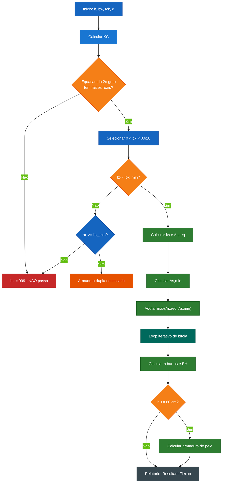
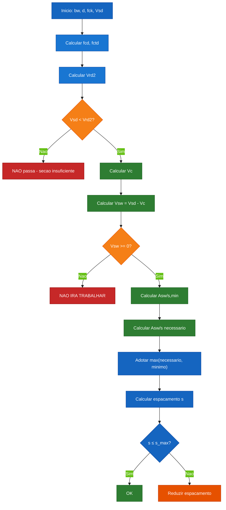
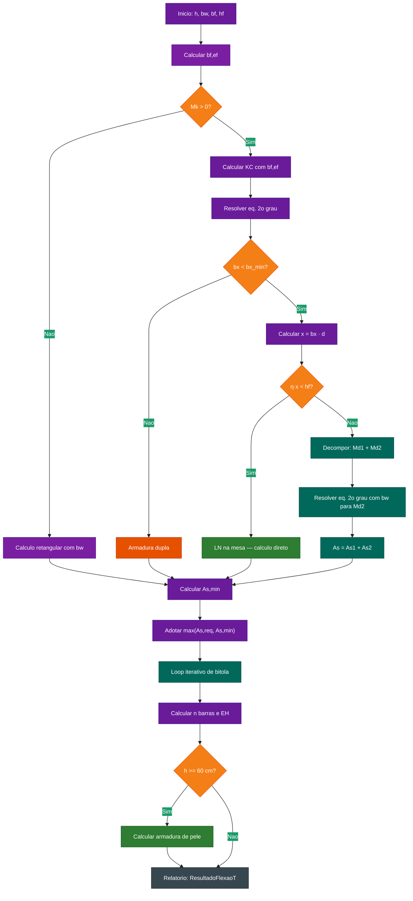

# Documentacao de Calculo – Portica App

Este documento descreve em detalhe o modelo de calculo estrutural implementado no
**Portica App**, com todas as formulas, hipoteses normativas e diagramas de fluxo
das verificacoes.

Para informacoes gerais sobre instalacao, execucao e arquitetura, consulte o
[README.md](../README.md) na raiz do repositorio.

> **Escopo deste documento.** Aqui estao as formulas, hipoteses e derivacoes
> implementadas no app. As tabelas e o texto da NBR 6118 **nao sao
> reproduzidos**: os dados normativos sao citados por item e vivem no codigo
> (por exemplo, `RHO_MIN_TABLE` e `CAA_DATA`). Para os valores, consulte a
> norma vigente.

---

## Indice

1. [Convencoes e unidades](#1-convencoes-e-unidades)
2. [Viga comum (secao retangular) – Flexao](#2-viga-comum-secao-retangular--flexao)
3. [Viga comum (secao retangular) – Cisalhamento](#3-viga-comum-secao-retangular--cisalhamento)
4. [Viga T (mesa colaborante) – Flexao](#4-viga-t-mesa-colaborante--flexao)
5. [Armadura dupla](#5-armadura-dupla)
6. [Armadura de pele](#6-armadura-de-pele)
7. [Dimensionamento iterativo de bitola](#7-dimensionamento-iterativo-de-bitola)
8. [ELS – Flecha](#8-els--flecha)
9. [ELS – Fissuracao](#9-els--fissuracao)
10. [Ajustes manuais ELS](#10-ajustes-manuais-els)
11. [Detalhamento de estribos por regiao](#11-detalhamento-de-estribos-por-regiao)
12. [Classes de agressividade ambiental (CAA)](#12-classes-de-agressividade-ambiental-caa)

---

## 1. Convencoes e unidades

As grandezas seguem o convencionado em calculo estrutural brasileiro:

- Forcas em kN (quilonewton)
- Momentos em kNm (quilonewton metro)
- Comprimentos em cm
- Tensoes em MPa (megapascal)
- Areas em cm² (centimetro quadrado)

Coeficientes de ponderacao e fatores parciais adotados:

| Grandeza            | Simbolo    | Valor       |
|---------------------|------------|-------------|
| Coef. do concreto   | `alpha_c`  | 0,85        |
| Coef. do concreto   | `gamma_c`  | 1,40        |
| Coef. do aco        | `gamma_s`  | 1,15        |
| Coef. das acoes     | `gamma_f`  | 1,30 (PP) / 1,40 (resto) |
| Fator de reducao    | `lambda`   | 0,80 (fck ≤ 50 MPa) |

Referencia normativa principal: **NBR 6118:2023** (Projeto de estruturas de concreto armado).

---

## 2. Viga comum (secao retangular) – Flexao

### 2.1 Altura util

A altura util `d` e calculada descontando-se da altura total `h` o cobrimento nominal
`c`, o diametro do estribo `phi_t` e metade do diametro da barra longitudinal `phi_l`:

```
d = h - c/10 - phi_t/10 - phi_l/20    (cm)
```

Onde:

- `c` vem da tabela `CAA_DATA` conforme a classe de agressividade (mm)
- `phi_t` e o diametro do estribo (mm)
- `phi_l` e o diametro da barra longitudinal mais externa (mm)

### 2.2 Coeficiente KC

O coeficiente `KC` e definido como:

```
KC = bw · d² / Md
```

Sendo:

- `bw`: largura da secao (cm)
- `d`: altura util (cm)
- `Md`: momento de calculo (kN·cm)

### 2.3 Equacao do segundo grau para a linha neutra

A posicao adimensional da linha neutra `bx = x/d` e obtida resolvendo a equacao de
equilibrio de momentos reduzida:

```
a · bx² + b · bx + c = 0

a = -0.192 · (fck/10) · KC
b =  0.48  · (fck/10) · KC
c = -1
```

Observacao: a implementacao utiliza `fck / 10` (em kN/cm²) para reproduzir a
calibracao empirica da planilha original.

A raiz valida `0 < bx < 0,628` (limite do dominio 3) e selecionada entre as duas
solucoes da equacao.

### 2.4 Verificacao do dominio de deformacao

Apos o calculo de `bx`, verifica-se o atendimento ao limite:

```
bx_min = 0,45  (fck ≤ 50 MPa)
bx_min = 0,35  (fck > 50 MPa)
```

O resultado e reportado como "SIM" (passa) ou "NAO" (nao passa).

### 2.5 Posicao da linha neutra

```
x = bx · d   (cm)
```

### 2.6 Calculo de As (armadura de tracao)

Para a regiao de dominio 2-3 com `bx < bx_min`, a area de aco necessaria e:

```
ks = 1 / (fyd · (1 - bx/2))
As,req = ks · Md / d
```

A armadura minima e dada por:

```
As,min = rho_min · bw · h / 100
```

Sendo `rho_min` lido da tabela `RHO_MIN_TABLE` (implementada em
`core/calculos/engenharia.py`), que reproduz os valores da taxa minima de
armadura de flexao da **NBR 6118:2023, item 17.3.5.2.1** para as secoes
retangular e T. A tabela normativa **nao e reproduzida aqui**: ela vive no
codigo, como dado de entrada do calculo, e deve ser conferida na norma
vigente (a tabela e interpolada linearmente entre os pontos da norma).

A armadura adotada e o maior valor entre `As,req` e `As,min`:

```
As,adot = max(As,req, As,min)
```

O numero de barras e obtido por:

```
n = ceil(As,adot / A_phi)
```

Onde `A_phi` e a area de uma barra de diametro `phi_l` (cm²).

### 2.7 Espacamento horizontal minimo

O espacamento horizontal livre entre barras e verificado por:

```
eh = (bw - 2·cob - 2·phi_t - n·phi_l) / (n - 1)
```

O criterio de aprovacao e `eh >= max(2,0 cm, phi_l, 1,2·dmax)`.

### 2.8 Tabela de bitolas candidatas

O motor calcula automaticamente uma tabela com 6 diâmetros candidatos
(`10, 12.5, 16, 20, 25, 32` mm) para que o usuário compare opções.
Cada entrada contém: quantidade de barras, área adotada, camadas, status (CABE / NÃO CABE)
e espaçamento real.

### 2.9 Fluxo da verificacao de flexao



---

## 3. Viga comum (secao retangular) – Cisalhamento

### 3.1 Solicitacao de calculo

A forca cortante de solicitacao `Vsd` e obtida multiplicando-se o modulo da
forca cortante caracteristica `Vk` pelo coeficiente de ponderacao `gamma_f`:

```
Vsd = |Vk| · gamma_f    (kN)
```

O usuario informa `Vk` em kN, **com sinal** (positivo ou negativo). O app
aplica o modulo `|Vk|` e majora por `gamma_f` internamente.

### 3.2 Resistencia de compressao diagonal do concreto (Vrd2)

Conforme NBR 6118:17.4.2.4:

```
Vrd2 = 0,27 · λ · fcd · bw · d    (kN)
```

Onde:

- `lambda = 0,80` para fck ≤ 50 MPa; `lambda = 1 - fck/250` para fck > 50 MPa
- `fcd = alpha_c · fck / gamma_c` (MPa)
- `bw`: largura da alma (cm)
- `d`: altura util (cm)

O criterio e `Vsd < Vrd2`.

### 3.3 Resistencia a compressao do concreto (fcd, fctm, fctk,inf, fctd)

```
fcd    = alpha_c · fck / gamma_c           (MPa)
fctm   = 0,30 · fck^(2/3)                  (MPa)
fctk,inf = 0,7 · fctm                      (MPa)
fctd   = fctk,inf / (gamma_c · 10)          (kN/cm²)
```

### 3.4 Contribuicao do concreto (Vc)

A contribuicao do concreto na resistencia ao cisalhamento (Modelo I) e:

```
Vc = 0,6 · fctd · bw · d    (kN)
```

### 3.5 Contribuicao do aco (Vsw)

```
Vsw = Vsd - Vc    (se Vsd > Vc)
Vsw = 0           (se Vsd ≤ Vc)
```

Se `Vsw ≤ 0`, a armadura transversal nao trabalha (verificacao "NAO IRA TRABALHAR").

### 3.6 Taxa minima de armadura transversal (Asw/s,min)

A taxa minima segue NBR 6118:17.4.2.4.2 e e obtida da tabela `ASW_S_TABLE_CA50`
conforme o `fck` e o tipo de aco do estribo (CA-50 ou CA-60).

### 3.7 Espacamento entre estribos

O espacamento e calculado a partir do estribo efetivamente escolhido:

```
s = Asw,ramo · 100 / Asw,usado    (cm)
```

Onde `Asw,ramo` e a area de 2 ramos do estribo (`2 * area` de uma barra `phi_t`).

### 3.8 Espacamento maximo (NBR 6118:18.3.3.2)

```
Se Vsd ≤ 0,67 · Vrd2:  s_max = min(0,6·d, 30 cm)
Se Vsd > 0,67 · Vrd2:  s_max = min(0,3·d, 20 cm)
```

### 3.9 Limite de fywd do estribo

Conforme NBR 6118:17.4.2.3, o valor de fywd é limitado a 435 MPa (43,5 kN/cm²):

```
fywd = min(fyk / gamma_s, 43,5)    (kN/cm²)
```

### 3.10 Fluxo da verificacao de cisalhamento



---

## 4. Viga T (mesa colaborante) – Flexao

### 4.1 Largura efetiva da mesa

Conforme NBR 6118:15.5.2, a largura efetiva `bf,ef` da mesa e limitada por:

```
bf,ef = min(bf, bw + b1esq + b1dir)
```

Com restricoes adicionais por vão:
```
b1 ≤ 0,1 · lo    (lo = distância entre pontos de momento nulo)
```

Caso `b1esq` ou `b1dir` nao sejam informados, considera-se `0,0 cm`.

### 4.2 Momento positivo (mesa comprimida)

Quando `Mk > 0`, a linha neutra pode estar na mesa ou na alma.

#### 4.2.1 LN na mesa (η·x < hf)

Se a condicao `η · x < hf` for satisfeita (onde `η = 0,8` para fck ≤ 50 MPa),
o calculo e feito com largura `bf,ef`:

```
KC = bf,ef · d² / Md
```

A equacao do segundo grau e a verificacao de dominio seguem o mesmo roteiro da
viga retangular, porem com `bf,ef` em vez de `bw`.

#### 4.2.2 LN na alma (η·x >= hf) — Decomposicao do momento

Quando `η · x >= hf`, a linha neutra esta na alma. O momento e decomposto em
duas parcelas:

**Parcela 1 — Momento resistido pelas abas (Md1):**

```
αc = 0,85  (fck ≤ 50 MPa)
αc = 0,85 · (1 - (fck-50)/200)  (fck > 50 MPa)

fcd' = αc · fck / (1,4 · 10)    (kN/cm²)

Md1 = fcd' · (bf,ef - bw) · hf · (d - hf/2)    (kN·cm)
```

**Parcela 2 — Momento resistido pela alma (Md2):**

```
Md2 = Md - Md1    (kN·cm)
```

Se `Md ≤ Md1`, toda a armadura e calculada com o braço de alavanca `(d - hf/2)`.

Se `Md2 > 0`, resolve-se a equacao do segundo grau com `bw` para encontrar `bx2`,
e a armadura total e:

```
As1 = Md1 / (fyd · (d - hf/2))    (abas)
As2 = ks2 · Md2 / d                (alma)
As,total = As1 + As2
```

### 4.3 Momento negativo (alma comprimida)

Quando `Mk < 0`, o calculo e identico ao da viga retangular com largura `bw`:

```
KC = bw · d² / Md
```

### 4.4 Fluxo da verificacao de viga T



---

## 5. Armadura dupla

Quando `Md > Md,lim` (momento excede o limite do dominio 3), e necessaria
armadura de compressão (As').

### 5.1 Momento limite

```
Md,lim = bw · d² / KC,lim

KC,lim = 1 / (fck/10 · bx_min · (0,48 - 0,192 · bx_min))
```

### 5.2 Calculo da armadura dupla

```
Md,excedente = Md - Md,lim

As1 = ks,lim · Md,lim / d           (tracionada limite)
As2 = Md,excedente / (fyd · (d - d'))  (tracionada adicional)
As' = As2                            (comprimida)

As,total = As1 + As2
```

Onde `d' = cob/10 + phi_t/10 + phi_l/20` (distancia da face comprimida ao CG da armadura de compressão).

### 5.3 Adocao de As'

O numero de barras de compressão e:

```
n' = ceil(As' / A_phi)
As',adotada = n' · A_phi
```

---

## 6. Armadura de pele

Conforme NBR 6118:2023, item 17.3.5.2.3:

### 6.1 Criterio de aplicacao

Vigas com `h >= 60 cm` exigem armadura lateral (de pele).

### 6.2 Area minima por face

```
As,pele,min = min(0,10% · A_c,alma, 5 cm²/m · h/100)

A_c,alma = bw · h    (cm²)
```

### 6.3 Espacamento maximo vertical

```
s_max = min(20 cm, d/3)
```

### 6.4 Restricao de diametro

O diametro da barra de pele deve ser menor ou igual ao diametro do estribo
(NBR 6118:17.3.5.2.3): `phi_pele ≤ phi_estribo`.

### 6.5 Selecao automatica

O motor testa os diametros `[6.3, 8, 10, 12.5, 16, 5]` mm e seleciona o menor
que atenda simultaneamente:

1. Area adotada >= area minima
2. Espacamento adotado <= espacamento maximo
3. phi_pele <= phi_estribo

---

## 7. Dimensionamento iterativo de bitola

### 7.1 Problema

A altura util `d` depende do diametro da barra escolhida, mas o diametro so e
conhecido apos o calculo de `As`, que depende de `d`. Esse ciclo exige iteracao.

### 7.2 Algoritmo

1. Estimativa inicial: `d₀ = h - cob/10 - phi_t/10 - phi_l/20`
2. Calcular `bx` e `As,req` com `d₀`
3. Detalhar barras com `BeamDetailer` → obter `d_real` (altura efetiva real)
4. Se `|d₀ - d_real| < tol` (1 mm), convergiu
5. Caso contrario, usar `d_real` como nova estimativa e repetir (max 5 iteracoes)

### 7.3 Detalhamento geometrico (BeamDetailer)

O `BeamDetailer` calcula a disposicao real das barras em camadas, considerando:

- Largura disponivel: `bw - 2·cob - 2·phi_t`
- Diametro do agregado graudo (`d_max = 19 mm` default)
- Espacamento horizontal minimo: `max(20 mm, phi_l, 1,2·d_max)`
- Quantidade de barras por camada e numero de camadas

Retorna: posicoes das barras, camadas, espacamento real, altura efetiva (`d_efetiva`).

---

## 8. ELS – Flecha

Verificacao conforme NBR 6118:17.3.2 (Estado Limite de Servico).

### 8.1 Modulo de elasticidade secante

```
Eci = 5600 · √fck    (MPa)
αe = 0,8 + 0,2 · (fck/80)
Ecs = Eci · αe / 1000    (GPa)
```

### 8.2 Parametros da secao

**Momento de inercia bruto (Ic):**

Para secao retangular:
```
Ic = bw · h³ / 12
```

Para secao T:
```
Ic = I_alma + I_mesa (com Steiner)
```

**Momento de fissuracao (Mr):**

```
Mr = α · fct · Ic / yt

α = 1,5  (secao retangular)
α = 1,3  (secao T)
```

### 8.3 Inercia equivalente (Branson)

```
Ieq = (Mr/Mk)³ · Ic + (1 - (Mr/Mk)³) · I_ii    (se Mr ≤ Mk)
Ieq = Ic                                           (se Mr > Mk)
```

### 8.4 Estadio II (secao fissurada)

Para secao retangular:
```
x_ii = d · (√(αe²·ρ² + 2·αe·ρ) - αe·ρ)
I_ii = bw · x_ii³/3 + αe · As · (d - x_ii)²
```

Para secao T (momento positivo):
1. Tenta `x_ii ≤ hf` com largura `bf`
2. Se `x_ii > hf`, resolve para LN na alma com decomposicao

### 8.5 Flecha por integracao numerica

O motor integra numericamente as curvaturas `κ(x) = M(x) / (Ecs · Ieq(x))` ao
longo do comprimento da viga, usando o metodo dos trapezios com condicoes de
contorno de viga bi-apoiada: `f(0) = 0` e `f(L) = 0`.

```
flecha_imediata = max|f(x)|
```

### 8.6 Flecha diferida (NBR 6118:17.3.2.1.2)

```
αf = 2,0  (tempo > 6 meses)
αf = (tempo/6) · 2,0  (tempo ≤ 6 meses)

flecha_diferida = αf · flecha_imediata
flecha_total = flecha_imediata + flecha_diferida
```

### 8.7 Limites (NBR 6118: Tabela 13.3)

```
limite_total = L / 250    (cm)
limite_ativo = L / 350    (cm)

passa_total = flecha_total ≤ limite_total
passa_ativo = flecha_diferida ≤ limite_ativo
```

---

## 9. ELS – Fissuracao

Verificacao conforme NBR 6118:17.3.3.

### 9.1 Tensao na armadura (Estadio II)

```
σs = αe · M_els · (d - x_ii) / I_ii · 10    (MPa)
```

### 9.2 Abertura de fissura (wk)

Duas formulas sao calculadas e adotado o menor valor:

**wk1 (diametro e resistencia):**
```
wk1 = (φ / (12,5 · ηb)) · (σs / 210000) · (3·σs / fct) · 10    (mm)
```

**wk2 (taxa de armadura da area de envolvimento):**
```
h_cr = min(2,5·(h-d), (h-x_ii)/3, 0,5·h)
A_cr = bw · h_cr    (ou area da mesa para viga T com tracao no topo)
ρ_ri = max(0,005, As / A_cr)

wk2 = (φ / (12,5 · ηb)) · (σs / 210000) · (4/ρ_ri + 45) · 10    (mm)
```

Onde `ηb = 2,25` (CA-50 nervurado).

### 9.3 Limites (NBR 6118: Tabela 13.4)

O limite de abertura de fissuras `w_k,lim` depende da classe de agressividade
ambiental e e o fixado pela **Tabela 13.4** da NBR 6118:2023. Essa tabela
normativa **nao e reproduzida aqui**: no app os limites por classe estao
centralizados em `CAA_DATA` (`core/calculos/engenharia.py`), junto dos demais
dados de classe de agressividade.

```
passa = wk_final ≤ w_k,lim
```

---

## 10. Ajustes manuais ELS

Quando a verificação de ELS não passa, o motor exibe um painel de ajustes manuais
que permite ao engenheiro explorar alternativas sem modificar o dimensionamento
automatico.

### 10.1 Opcoes disponiveis

| Ajuste            | Descricao                                              |
|-------------------|--------------------------------------------------------|
| `barras_extras`   | Adicionar 0-10 barras extras à armadura de tracao      |
| `phi_minimo_mm`   | Forcar um diametro minimo das barras (10-32 mm)        |
| `h_override_cm`   | Sobrescrever a altura da viga                          |
| `fck_override_mpa`| Sobrescrever a resistencia do concreto                 |

### 10.2 Efeito dos ajustes

- **Barras extras**: aumenta `As` em `n_extras · π·(φ/20)²` cm², recalcula
  o layout geometrico (`BeamDetailer`) e a armadura de pele se necessario.
- **Phi minimo**: altera o diametro usado no calculo de `d` e na fissuracao.
- **h override**: altera `h`, recalcula `d` e todos os parametros dependentes.
- **fck override**: altera `fck`, recalcula `fcd`, `fctm`, `Ecs`, etc.

### 10.3 Recalculo

Ao clicar em "Recalcular com Ajustes", o motor recalcula toda a cadeia:
flexao → cisalhamento → ELS (flecha + fissuracao) → detalhamento.
Os resultados sao atualizados no modal sem fechar/reabrir.

---

## 11. Detalhamento de estribos por regiao

### 11.1 Criterio

O motor divide o comprimento da viga em regioes conforme o diagrama de cortante.
Para cada regiao, calcula o estribo adequado considerando:

- Cortante maxima da regiao
- Espacamento maximo normativo (item 3.8)
- Taxa minima de armadura transversal

### 11.2 Saida

Para cada regiao, retorna:
- Trecho (x_inicio – x_fim)
- Diametro do estribo
- Espacamento adotado
- Asw/s (cm²/m)

---

## 12. Classes de agressividade ambiental (CAA)

A classe de agressividade ambiental (CAA) e um dado de **entrada** do app: o
usuario informa a CAA e o motor busca os parametros normativos correspondentes
(cobrimento nominal, limite de fissuracao e `fck,min` recomendado) na
estrutura `CAA_DATA`, implementada em `core/calculos/engenharia.py`. Os
valores vem das tabelas da **NBR 6118:2023** (itens 6.4.2 e 7.4.2, tabela 7.2,
e tabela 13.4) e **nao sao reproduzidos neste documento**: a tabela normativa
deve ser consultada na norma vigente.

O que o motor faz com a CAA:

- **Cobrimento nominal** -> define `c` e, portanto, a altura util `d`
  (`d = h - c/10 - phi_t/10 - phi_l/20`);
- **Area de envolvimento** -> define `h_cr`/`A_cr` no calculo de fissuracao;
- **Limite de fissuracao** -> `w_k,lim` na verificacao de ELS;
- **fck,min** -> alerta de adequacao do concreto a classe informada.

A tabela de CAA exibida na interface (dialogo de tabelas) tambem reproduz os
dados da norma; ela deve ser conferida na norma vigente.

---

[Voltar para o README principal](../README.md)
